# Telco Customer Churn Prediction — Multi-Algorithm Classification Showdown

[](https://www.python.org/)
[](https://scikit-learn.org/)
[](LICENSE)

An end-to-end Supervised Learning classification system built to predict subscriber churn for a major telecommunications provider (mirroring operations at Jio or Airtel). This project benchmarks **K-Nearest Neighbors (KNN)**, **Gaussian Naive Bayes**, **Support Vector Machines (SVM)**, and **Decision Tree Classifiers**, addresses class imbalance via **SMOTE** and cost-sensitive weighting, and serializes a production-grade inference pipeline (`churn_model.pkl`).

---

## 📌 Executive Business Summary

- **Industry Setting:** Major telecom operator losing subscribers month-over-month.
- **Economic Motivation:** Customer Acquisition Cost (CAC) is 5x–7x higher than Customer Retention Cost. Retaining existing subscribers protects Customer Lifetime Value (CLV).
- **Operational Constraint:** Outbound retention call centers maintain a capacity of **~500 high-touch calls per day**.
- **Primary Optimization KPI:** **Recall on the Churn Class** (minimizing False Negatives, because missing a real churner forfeits recurring revenue and incurs replacement CAC).

---

## 📂 Repository Structure

```text
telco-churn-supervised-learning/
│
├── CustomerChurn_SupervisedLearning.ipynb   # Fully executed end-to-end Jupyter Notebook
├── PR-5.ipynb                               # Matching project notebook
├── churn_model.pkl                          # Serialized scikit-learn Pipeline (Preprocessor + Best Model)
├── summary_report.md                        # Strategic executive report for retention leadership (~500 words)
├── requirements.txt                         # Dependency specifications
├── README.md                                # Project documentation & quickstart guide
└── Final-PR.csv                             # IBM Telco Customer Churn dataset (7,043 rows, 21 columns)
```

---

## 📊 Dataset Overview

The dataset mirrors real subscriber records from the **IBM Telco Customer Churn benchmark**:
- **Subscribers:** 7,043
- **Features:** 21 attributes (Demographics, Services, Contract Terms, Billing, Payment Method)
- **Target Variable:** `Churn` (No = 5,174 [73.46%], Yes = 1,869 [26.54%])
- **Dataset Source:** [Kaggle / IBM Telco Customer Churn Dataset](https://www.kaggle.com/datasets/blastchar/telco-customer-churn)

---

## 🔧 Workflow & Methodology

```mermaid
flowchart LR
    A["Raw Telecom Data (7,043 rows)"] --> B["Data Hygiene & Median Imputation"]
    B --> C["Feature Engineering (tenure_group, num_services, AutoPay)"]
    C --> D["Encoding & Feature Scaling (StandardScaler)"]
    D --> E["Stratified 80/20 Train-Test Split"]
    E --> F["SMOTE Resampling (Train Set Only)"]
    F --> G["Model Benchmarking (KNN, NB, SVM, Decision Tree)"]
    G --> H["Hyperparameter Tuning & Error Analysis"]
    H --> I["Pipeline Serialization (churn_model.pkl)"]
```



1. **Data Cleaning:** Investigated `TotalCharges` object datatype; identified 11 whitespace strings belonging to brand-new subscribers (`tenure = 0`), converted to `float64`, and imputed missing values with the dataset median ($1,397.48).
2. **Feature Engineering:**
   - `tenure_group`: Ordinal binning into `New` (0–12 mo), `Mid` (13–36 mo), `Senior` (37–60 mo), and `Loyal` (61+ mo).
   - `num_services`: Aggregated count of add-on subscriptions (`OnlineSecurity`, `OnlineBackup`, `DeviceProtection`, `TechSupport`, `StreamingTV`, `StreamingMovies`).
   - `AutoPay`: Flagged frictionless bank/credit card automatic transfers.
3. **Encoding & Scaling:** One-Hot Encoded multi-category variables (`drop_first=True`), mapped binary fields to 0/1, and applied `StandardScaler` to continuous numerical features.
4. **Class Imbalance Mitigation:** Applied **SMOTE** strictly on the training set to achieve a 1:1 balanced distribution (4,139 Stay vs 4,139 Churn), keeping the test set pristine.

---

## 🏆 Model Performance Benchmark

Models evaluated on the unseen 20% test set (1,409 subscribers), sorted by **Recall (Churn Class)**:

| Rank | Model Architecture | Recall (Churn KPI) | Precision (Churn) | F1-Score | AUC-ROC | Training Time |
| :---: | :--- | :---: | :---: | :---: | :---: | :---: |
| 🥇 | **Decision Tree (depth=4)** | **78.34%** | **51.13%** | **0.6188** | **0.8176** | **0.021s** |
| 🥈 | **Gaussian Naive Bayes** | 77.54% | 50.35% | 0.6105 | 0.8229 | 0.009s |
| 🥉 | **K-Nearest Neighbors (k=3)** | 67.91% | 47.65% | 0.5601 | 0.7510 | 0.003s |
| 4 | **SVM (RBF Kernel, C=100)** | 62.03% | 50.99% | 0.5597 | 0.7794 | 6.165s |

### Why Decision Tree is Deployed:
- **Maximized Churn Capture:** Highest Recall (78.34%) ensures ~8 out of 10 churners are flagged.
- **Explainability:** Generates transparent, human-readable rules (e.g., contract type, tenure, fiber optic, tech support) that arm retention call center agents with specific reasons for counter-offers.
- **Production Efficiency:** Microsecond inference latency enables batch scoring across tens of millions of subscribers in minutes.

---

## 🔍 Key Business Findings & Retention Strategy

1. **Contract Type Dominance:** Month-to-month subscribers churn at **42.7%**, compared to **11.3% for 1-year** and **2.8% for 2-year** contracts.
   - *Action:* Offer ₹200 / $10 monthly discounts or free streaming bundles to migrate customers to 12-month commitments.
2. **Early Lifecycle Vulnerability:** First-year churn is **47.4%**, tapering to **<7%** after year 4.
   - *Action:* Institute automated 30-60-90 day proactive customer care outreach.
3. **High-ARPU Fiber Risk:** Fiber optic subscribers without tech support churn at near double the rate of DSL subscribers due to outage frustrations.
   - *Action:* Bundle free 6-month Tech Support and guarantee expedited field service for high-tier fiber plans.
4. **Capacity Optimization for 500 Calls/Day:**
   - Sort scored subscribers by predicted churn probability $P(\text{Churn})$ in descending order.
   - Route the top 500 highest-probability churners daily to call center queues, maximizing retention ROI.

---

## 🚀 How to Run & Reproduce

### 1. Clone & Set Up Environment
```bash
git clone https://github.com/your-username/telco-churn-supervised-learning.git
cd telco-churn-supervised-learning

# Create virtual environment
python -m venv venv
# Activate on Windows:
venv\Scripts\activate
# Activate on Linux/macOS:
source venv/bin/activate

# Install dependencies
pip install -r requirements.txt
```

### 2. Run the Notebook
```bash
jupyter notebook CustomerChurn_SupervisedLearning.ipynb
# or
jupyter notebook PR-5.ipynb
```

### 3. Load Model & Run Real-Time Inference
```python
import joblib
import pandas as pd

# Load serialized production pipeline
pipeline = joblib.load('churn_model.pkl')

# Example new customer payload
new_customer = pd.DataFrame([{
    'gender': 1,
    'SeniorCitizen': 0,
    'Partner': 0,
    'Dependents': 0,
    'tenure': 2,
    'PhoneService': 1,
    'MultipleLines': 0,
    'InternetService_Fiber optic': 1,
    'InternetService_No': 0,
    'OnlineSecurity': 0,
    'OnlineBackup': 0,
    'DeviceProtection': 0,
    'TechSupport': 0,
    'StreamingTV': 1,
    'StreamingMovies': 1,
    'Contract_One year': 0,
    'Contract_Two year': 0,
    'PaperlessBilling': 1,
    'PaymentMethod_Credit card (automatic)': 0,
    'PaymentMethod_Electronic check': 1,
    'PaymentMethod_Mailed check': 0,
    'MonthlyCharges': 89.85,
    'TotalCharges': 179.70,
    'tenure_group': 0,
    'num_services': 2,
    'AutoPay': 0
}])

# Predict churn probability
churn_prob = pipeline.predict_proba(new_customer)[0, 1]
churn_pred = pipeline.predict(new_customer)[0]

print(f"Churn Probability: {churn_prob * 100:.2f}%")
print(f"Status: {'High Churn Risk - Trigger Outreach' if churn_pred == 1 else 'Normal'}")
```

---

## 📜 License
This project is open-source and distributed under the MIT License.
