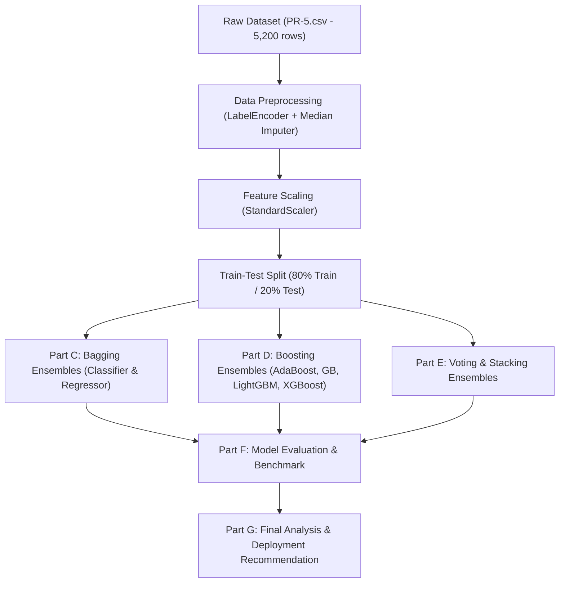

# PR-5: Smart Outcome Predictor — Ensemble Machine Learning System

[](https://www.python.org/)
[](https://scikit-learn.org/)
[](https://jupyter.org/)

An end-to-end ensemble machine learning system designed to predict student performance and engagement outcomes for an EdTech analytics platform. This project implements, benchmarks, and analyzes **Bagging**, **Boosting (AdaBoost, Gradient Boosting, LightGBM, XGBoost)**, **Voting**, and **Stacking** ensembles across both **Classification** and **Regression** tasks.

---

## 📌 Problem Statement & Objectives

Working as a **Machine Learning Engineer** at an EdTech analytics company, the goal is to build a **Smart Outcome Predictor**:
1. **Classification Task:** Predict whether a student will *successfully complete* an online course (`completion_status`: `0` = Not Completed, `1` = Completed).
2. **Regression Task:** Predict the *final performance score* of a student (`final_score`: `0` to `100`).

Single base models (like standalone decision trees) produce unstable and high-variance predictions. This project explores ensemble techniques to improve generalization, stability, and predictive performance.

---

## 📂 Project Structure

```text
PR-5/
│
├── PR-5.ipynb        # Fully executed Jupyter Notebook (Questions 1 to 31)
├── PR-5.csv          # Student engagement dataset (5,200 records, 19 columns)
└── README.md         # Project documentation and performance benchmark
```

---

## 📊 Dataset Overview (`PR-5.csv`)

The dataset contains **5,200 student records** with **19 attributes**:
- **Demographic Indicators:** `student_id`, `age`, `country_region`, `device_type`, `education_background`
- **Course Attributes:** `course_level`, `course_category`, `course_start_date`, `week_of_year`
- **Engagement Metrics:** `sessions`, `time_spent_hours`, `videos_watched`, `quiz_attempts`, `assignments_submitted`, `forum_posts`, `attendance_rate`
- **Assessment Scores:** `avg_quiz_score`
- **Target Variables:**
  - `completion_status` $\rightarrow$ Classification (`0` = Not Completed, `1` = Completed)
  - `final_score` $\rightarrow$ Regression (`0.0` – `100.0`)

---

## 🛠️ Workflow & Methodology



1. **Preprocessing & Feature Engineering:**
   - Excluded non-predictive identifiers (`student_id`, `course_start_date`).
   - Encoded categorical text features using `LabelEncoder`.
   - Imputed missing values in `time_spent_hours`, `avg_quiz_score`, and `attendance_rate` using `SimpleImputer(strategy='median')`.
   - Scaled features with `StandardScaler`.
   - Split into 80% training (4,160 rows) and 20% testing (1,040 rows).

2. **Ensemble Modeling Techniques:**
   - **Bagging:** Parallel bootstrap sampling using Decision Trees to reduce variance.
   - **Boosting:** Sequential weak learners reducing bias (AdaBoost, Gradient Boosting, LightGBM, XGBoost).
   - **Voting:** Hard vs Soft Voting combining predictions from diverse classifiers.
   - **Stacking:** Heterogeneous base learners combined via meta-models (`LogisticRegression` and `LinearRegression`).

---

## 🏆 Model Performance & Comparison Benchmark

### 1. Classification Task: Course Completion Prediction (`completion_status`)

Evaluated on the holdout test set (1,040 students):

| Rank | Model | Accuracy (%) | Precision | Recall | F1-Score | ROC-AUC |
| :---: | :--- | :---: | :---: | :---: | :---: | :---: |
| 🥇 | **XGBoost Classifier** | **74.04%** | **0.6869** | **0.5739** | **0.6250** | **0.7950** |
| 🥈 | **Soft Voting Classifier** | **73.94%** | 0.6854 | 0.5718 | 0.6234 | 0.7928 |
| 🥉 | **Gradient Boosting Classifier** | **73.85%** | 0.6826 | 0.5718 | 0.6223 | 0.7922 |
| 4 | **Stacking Classifier** | 73.65% | 0.6778 | 0.5718 | 0.6199 | 0.7915 |
| 5 | **AdaBoost Classifier** | 73.37% | 0.6697 | 0.5718 | 0.6169 | 0.7856 |
| 6 | **LightGBM Classifier** | 73.37% | 0.6728 | 0.5676 | 0.6157 | 0.7857 |
| 7 | **Bagging Classifier** | 70.48% | 0.6203 | 0.5487 | 0.5823 | 0.7583 |
| - | *Single Decision Tree (Baseline)* | *62.40%* | *0.4932* | *0.4907* | *0.4919* | *0.6012* |

> **Key Classification Finding:** All ensemble methods significantly outperformed the single Decision Tree baseline (+11.6% accuracy gain). **XGBoost** and **Soft Voting** achieved the highest accuracy and discrimination power (ROC-AUC ~0.795).

---

### 2. Regression Task: Final Score Prediction (`final_score`)

Evaluated on the holdout test set (1,040 students):

| Rank | Model | MAE | RMSE | $R^2$-Score |
| :---: | :--- | :---: | :---: | :---: |
| 🥇 | **Stacking Regressor** | **7.8860** | **9.8300** | **0.4827** |
| 🥈 | **Gradient Boosting Regressor** | 7.9158 | 9.8795 | 0.4776 |
| 🥉 | **XGBoost Regressor** | 7.9458 | 9.8906 | 0.4764 |
| 4 | **LightGBM Regressor** | 8.0125 | 9.9678 | 0.4682 |
| 5 | **Bagging Regressor** | 8.1080 | 10.1298 | 0.4508 |
| 6 | **AdaBoost Regressor** | 8.5451 | 10.4871 | 0.4114 |
| - | *Single Decision Tree (Baseline)* | *11.1420* | *14.1804* | *-0.0220* |

> **Key Regression Finding:** A single unpruned decision tree completely overfits on training data ($R^2 < 0$ on test set). The **Stacking Regressor** (combining AdaBoost and Gradient Boosting through a Linear Regression meta-learner) delivers the lowest error and highest explained variance ($R^2 = 0.4827$).

---

## 📋 Summary of Questions Answered in Notebook

| Part | Questions | Description |
| :--- | :--- | :--- |
| **Part A** | Q1 – Q5 | Conceptual Theory: Ensembles, Bagging vs Boosting, Bias-Variance, Stacking, Model Comparisons |
| **Part B** | Q6 – Q8 | Feature & Target Identification, 80/20 Train-Test Splits, Encoding & Scaling |
| **Part C** | Q9 – Q11 | Bagging Classifier, Bagging Regressor, Comparison vs Single Decision Tree |
| **Part D** | Q12 – Q23 | AdaBoost, Gradient Boosting, LightGBM, XGBoost, Learning Rate & Estimator Tuning |
| **Part E** | Q24 – Q27 | Voting Classifier (Hard vs Soft), Stacking Classifier & Stacking Regressor |
| **Part F** | Q28 – Q30 | Comprehensive Evaluation Tables (Accuracy, Precision, Recall, F1, AUC, MAE, RMSE, $R^2$) |
| **Part G** | Q31 | Final Analysis Report: Bagging vs Boosting, Tree Comparisons, Voting/Stacking, Recommendations |

---

## 🚀 How to Run

1. **Clone the repository:**
   ```bash
   git clone https://github.com/your-username/edtech-smart-outcome-predictor.git
   cd PR-5
   ```

2. **Install dependencies:**
   ```bash
   pip install pandas numpy scikit-learn matplotlib seaborn jupyter
   ```

3. **Launch the Jupyter Notebook:**
   ```bash
   jupyter notebook PR-5.ipynb
   ```

---

## 📌 Key Business Recommendations for Deployment

1. **Course Completion Monitoring:** Deploy the **XGBoost / Soft Voting Classifier** to flag at-risk learners early in the semester. Students predicted as `0` (Not Completed) can be automatically routed to automated study reminders, mentor check-ins, or interactive learning nudges.
2. **Grade Prediction System:** Deploy the **Stacking Regressor** to project continuous student grades (`final_score`). Identifying students trending toward low scores allows instructors to provide timely intervention before midterm exams.
3. **Efficiency vs Accuracy:** For real-time scoring in web applications, **LightGBM** provides sub-millisecond latency with accuracy nearly indistinguishable from full stacking ensembles.

---


